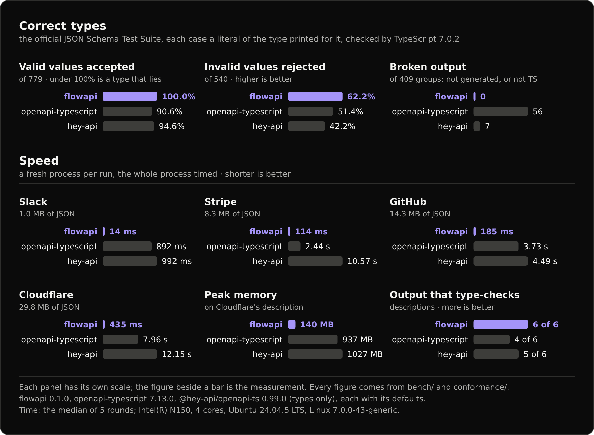

<h1 align="center">flowapi</h1>

<p align="center"><b>Types from API descriptions that follow the specification.</b><br>
OpenAPI 3.0, 3.1 and 3.2 and JSON Schema in, TypeScript out (Rust next). Every value a schema
accepts, its type accepts: checked on the official JSON Schema Test Suite.</p>

<p align="center"><a href="#how-it-holds-to-the-specification">Conformance</a> ·
<a href="#speed">Speed</a> · <a href="#use">Use</a> · <a href="#how-it-works">How it works</a></p>

<p align="center">
  
</p>

<p align="center">
  
</p>

## How it holds to the specification

For every schema in the official
[JSON-Schema-Test-Suite](https://github.com/json-schema-org/JSON-Schema-Test-Suite), flowapi prints
a type, and each test value is written as a literal of that type and handed to the TypeScript
compiler (`strict`, `exactOptionalPropertyTypes`). If the compiler refuses a valid value, the type
is wrong. If it refuses an invalid one, the type caught it.

| Draft 2020-12 | Result |
| --- | --- |
| Valid values accepted (soundness) | **100.0%** (779 of 779) |
| Invalid values rejected (precision) | 62.2% (336 of 540) |
| Groups that failed to generate, or printed invalid TypeScript | 0 of 409 |

From [conformance/results/suite.md](conformance/results/suite.md). The same measurement, each
schema wrapped as an OpenAPI 3.1 component and each tool run with its defaults
([conformance/results/compare.md](conformance/results/compare.md)):

| Generator | Valid accepted | Invalid rejected | Failed to generate | Invalid TypeScript |
| --- | ---: | ---: | ---: | ---: |
| flowapi 0.1.0 | **100.0%** | **62.2%** | 0 | 0 |
| openapi-typescript 7.13.0 | 90.6% | 51.4% | 7 | 49 |
| @hey-api/openapi-ts 0.99.0 | 94.6% | 42.2% | 7 | 0 |

TypeScript has no type for some keywords (`pattern`, `minimum`, `uniqueItems`). There the type
accepts more than the schema does, and a comment above it names the keywords it does not check.
Every keyword of every dialect is handled one of three ways: it becomes part of the type, it is
listed in that comment, or it is read as an annotation. The JSON reader is our own and passes
[JSONTestSuite](https://github.com/nst/JSONTestSuite).

## Speed

Each tool ran as a fresh process on real descriptions, five rounds each, on an Intel N150. The
times are medians
([bench/results/speed.md](bench/results/speed.md)):

| Description | Size | flowapi | openapi-typescript 7.13 | @hey-api/openapi-ts 0.99 |
| --- | ---: | ---: | ---: | ---: |
| Slack | 999 KB | 14 ms | 892 ms | 992 ms |
| Stripe | 8.3 MB | 114 ms | 2.44 s | 10.57 s |
| GitHub | 14.3 MB | 185 ms | 3.73 s | 4.49 s |
| Cloudflare | 29.8 MB | 435 ms | 7.96 s | 12.15 s |

On Cloudflare's description flowapi peaks at 140 MB of memory; the other two take 937 MB and
1027 MB. flowapi's output type-checks for all six descriptions in the benchmark. The limits it is
held to are in [bench/budgets.json](bench/budgets.json).

## Use

```sh
cargo run --release -p flowapi-cli -- openapi.json -o types.ts
```

```ts
// One type for each component schema and each operation, and Paths:
export type Pet = {
  /** Unique within the store. */
  id: number;
  kind: "cat" | "dog";
  tags?: [string, ...string[]];
  [key: `x-${string}`]: string;
};
export type GetPet = {
  parameters: {
    path: {
      id: number;
    };
  };
  responses: {
    "200": {
      headers: {
        "X-Rate-Limit": number;
      };
      content: {
        "application/json": Pet;
      };
    };
  };
};
export type Paths = {
  "/pets/{id}": {
    get: GetPet;
  };
};
```

If the schema lets an object hold other properties, its type has an index signature for them.
Files that a `$ref` names by relative path are read too, and so are YAML descriptions (`.yaml`,
`.yml`, or any file that does not open with `{` or `[`). YAML is read as JSON's data model under
YAML 1.2's core schema: a key that is not a string becomes its JSON text (`200:` is `"200"`) and
anchors are expanded. What JSON cannot hold is an error with the YAML line and column: `.inf`
and `.nan`, a mapping as a key, a repeated key, `<<` merge keys, a second document, or aliases
that would copy more than a million nodes. The YAML reader passes the YAML test suite
(`crates/flowapi-cli/tests/yaml_suite.rs`).

## How it works

The core (`crates/flowapi`) reads the documents into a graph of types that belongs to no
language. It keeps the byte offset of every JSON node for error messages, resolves `$ref` through
`$id` and `$anchor`, and builds schemas from a work queue, so a long chain of references cannot
overflow the stack. Names are chosen in one pass at the end. The core reads no files and has no
dependencies, and it builds for WebAssembly. Each target language is its own crate; TypeScript is
`crates/flowapi-ts`. The rules are in [AGENTS.md](AGENTS.md).

MIT. Made by [Localix Lab](https://localix.ai).
