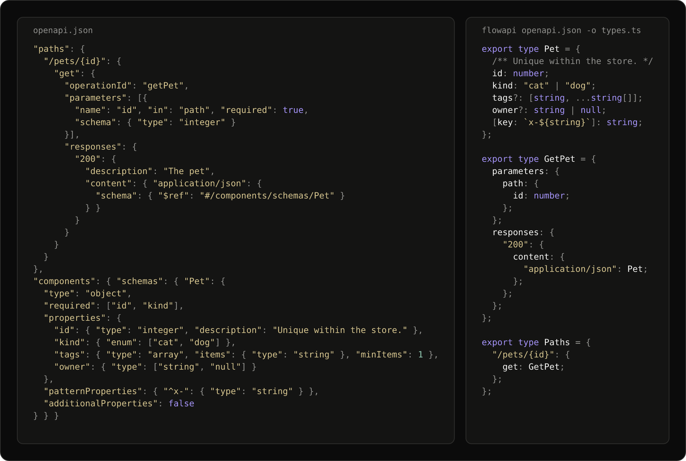

<h1 align="center">flowapi</h1>

<p align="center"><b>Types from API descriptions that follow the specification.</b><br>
Swagger 2.0, OpenAPI 3.0, 3.1 and 3.2 and JSON Schema in, TypeScript or Rust out. Every value a schema
accepts, its type accepts: checked on the official JSON Schema Test Suite.</p>

<p align="center"><a href="#how-it-holds-to-the-specification">Conformance</a> ·
<a href="#speed">Speed</a> · <a href="#use">Use</a> · <a href="#how-it-works">How it works</a></p>

<p align="center">
  
</p>

<p align="center">
  
</p>

## How it holds to the specification

For every schema in the official
[JSON-Schema-Test-Suite](https://github.com/json-schema-org/JSON-Schema-Test-Suite), flowapi prints
a type, and each test value is written as a literal of that type and handed to the TypeScript
compiler (`strict`, `exactOptionalPropertyTypes`). If the compiler refuses a valid value, the type
is wrong. If it refuses an invalid one, the type caught it.

| Draft 2020-12 | Result |
| --- | --- |
| Valid values accepted (soundness) | **100.0%** (779 of 779) |
| Invalid values rejected (precision) | 69.0% (373 of 540) |
| Groups that failed to generate, or printed invalid TypeScript | 0 of 409 |

From [conformance/results/suite.md](conformance/results/suite.md). The same measurement, each
schema wrapped as an OpenAPI 3.1 component and each tool run with its defaults
([conformance/results/compare.md](conformance/results/compare.md)):

| Generator | Valid accepted | Invalid rejected | Failed to generate | Invalid TypeScript |
| --- | ---: | ---: | ---: | ---: |
| flowapi 0.1.0 | **100.0%** | **69.0%** | 0 | 0 |
| openapi-typescript 7.13.0 | 90.6% | 51.4% | 7 | 49 |
| @hey-api/openapi-ts 0.99.0 | 94.6% | 42.2% | 7 | 0 |

TypeScript has no type for some keywords (`pattern`, `minimum`, `uniqueItems`). There the type
accepts more than the schema does, and a comment above it names the keywords it does not check.
Every keyword of every dialect is handled one of three ways: it becomes part of the type, it is
listed in that comment, or it is read as an annotation. The JSON reader is our own and passes
[JSONTestSuite](https://github.com/nst/JSONTestSuite).

The suite has a few hundred schemas, so two more checks look past it. Thousands of random
schemas and values are generated from fixed seeds; our own validator, flowschema (which passes
the whole suite), says which values are valid, and every valid one must type-check against
flowapi's type ([conformance/results/props.md](conformance/results/props.md)). And every valid
example description the OAI keeps beside its schemas generates and type-checks
([conformance/results/oai.md](conformance/results/oai.md)). A requirements ledger lists every
MUST, SHOULD and MAY of OpenAPI 3.0.4, 3.1.2, 3.2.1 and JSON Schema 2020-12 that a types
generator answers to, each held by a test or named as something a type cannot state
([conformance/REPORT.md](conformance/REPORT.md)).

One TypeScript limit shows in rare cases: an object literal with a key named like a member
every object inherits (`constructor`, `toString`) is checked against `Object`'s member when the
key is not declared, so `{ constructor: [0] }` can be refused by a type that allows it.

## Speed

Each tool ran as a fresh process on real descriptions, five rounds each, on an Intel N150. The
times are medians
([bench/results/speed.md](bench/results/speed.md)):

| Description | Size | flowapi | openapi-typescript 7.13 | @hey-api/openapi-ts 0.99 |
| --- | ---: | ---: | ---: | ---: |
| Slack | 999 KB | 14 ms | 892 ms | 992 ms |
| Stripe | 8.3 MB | 114 ms | 2.44 s | 10.57 s |
| GitHub | 14.3 MB | 185 ms | 3.73 s | 4.49 s |
| Cloudflare | 29.8 MB | 435 ms | 7.96 s | 12.15 s |

On Cloudflare's description flowapi peaks at 140 MB of memory; the other two take 937 MB and
1027 MB. flowapi's output type-checks for all six descriptions in the benchmark. The limits it is
held to are in [bench/budgets.json](bench/budgets.json).

## Use

```sh
cargo run --release -p flowapi-cli -- openapi.json -o types.ts
```

```ts
// One type for each component schema and each operation, and Paths:
export type Pet = {
  /** Unique within the store. */
  id: number;
  kind: "cat" | "dog";
  tags?: [string, ...string[]];
  [key: `x-${string}`]: string;
};
export type GetPet = {
  parameters: {
    path: {
      id: number;
    };
  };
  responses: {
    "200": {
      headers: {
        "X-Rate-Limit": number;
      };
      content: {
        "application/json": Pet;
      };
    };
  };
};
export type Paths = {
  "/pets/{id}": {
    get: GetPet;
  };
};
```

If the schema lets an object hold other properties, its type has an index signature for them.
Swagger 2.0 descriptions are read too, into the same types as 3.x: `definitions` are the named
types, a `body` or `formData` parameter is the request body under each media type the
operation consumes, and a response's `schema` is its content under each type it produces.
A relative `$ref` resolves against the document's own URI: the path you give the command, or
the URI the library is given with each document; flowapi assumes no other base.
Files that a `$ref` names by relative path are read too, and so are YAML descriptions (`.yaml`,
`.yml`, or any file that does not open with `{` or `[`). YAML is read as JSON's data model under
YAML 1.2's core schema: a key that is not a string becomes its JSON text (`200:` is `"200"`) and
anchors are expanded. What JSON cannot hold is an error with the YAML line and column: `.inf`
and `.nan`, a mapping as a key, a repeated key, `<<` merge keys, a second document, or aliases
that would copy more than a million nodes. The YAML reader passes the YAML test suite
(`crates/flowapi-cli/tests/yaml_suite.rs`).

### An SDK, with no HTTP library

`--sdk` adds two functions per operation after the types: `<op>Request(input)` writes the request
and sends nothing, `<op>Response(status, headers, body)` reads the answer you got back. Use any
HTTP client, or none in a test.

```sh
cargo run --release -p flowapi-cli -- openapi.json --sdk -o api.ts
```

```ts
const r = getPetRequest({ path: { id: 7 }, query: { tags: ["a b", "c"] } })
// { method: "GET", path: "/pets/7", query: "tags=a%20b&tags=c", headers: {} }
const res = await fetch(base + r.path + (r.query && "?" + r.query), r)
const out = getPetResponse(res.status, Object.fromEntries(res.headers), await res.text())
if (out.response === "200") out.body // Pet, parsed from JSON
```

Parameters are written as their `style`, `explode` and `allowReserved` say (`simple`, `label`,
`matrix`, `form`, `spaceDelimited`, `pipeDelimited`, `deepObject` and 3.2's `cookie`; Swagger
2.0's `collectionFormat` read as those), percent-encoded per RFC 3986 everywhere but headers and
`style: cookie`, which pass as given; a parameter with `content` as its media type's text; cookies
into one `cookie` header. The body is `{ contentType, value }` of one of the operation's media
types: JSON, a form, or text as given (a multipart body is yours to write). A response is picked
by its status (the code, then `2XX`, then `default`) and its `Content-Type`; a JSON body is
parsed, any other is the text, and what the description does not name comes back as
`response: null` with the text (a leading byte order mark is skipped before JSON is parsed).
`<op>Request` throws a `FlowapiRequestError` (exported, with `location`, `parameter` and
`reason`) rather than write a request that would mean something else: a CR, LF or NUL in a header
or a `style: cookie` value (`control-character`), a path parameter that leaves its segment empty
or makes it `.` or `..` (`empty-segment`, `dot-segment`; `%2E` is a dot too), NaN or an infinity
anywhere in a parameter or a JSON or form body (`non-finite`: JSON has no such number, and
`JSON.stringify` would write `null`). A header's name that is not a token is left out of the
operation, with a warning. The output imports nothing: the runtime is a few functions
printed once. The base URL is yours (servers are not read). Every row of the specification's
Style Examples table, the pitfalls other generators fixed, and the SDKs of GitHub's, Stripe's and
Cloudflare's descriptions are run or type-checked
([conformance/results/sdk.md](conformance/results/sdk.md)); writing a request against
openapi-fetch's serializers: [bench/results/sdk.md](bench/results/sdk.md).

For Rust, `--target rust --sdk` prints the same after the serde types: per operation an input
struct, `<op>_request(&input)`, which returns an `sdk::Request` (method, path, query, headers, and
the body's content type and bytes) or an `sdk::RequestError` for what the TypeScript SDK refuses,
with the same `reason` codes (`Reason::code()`), and `<op>_response(status, headers, body)`, which returns an
enum of the operation's responses or an `sdk::Error` holding the answer. No I/O, no async; the
runtime is a module printed once (`pub mod sdk`) and needs serde and serde_json, as the types do.

```sh
cargo run --release -p flowapi-cli -- openapi.json --target rust --sdk -o src/api.rs
```

```rust
let r = api::get_pet_request(&api::GetPetInput { parameters: params })?;
// sdk::Request { method: "GET", path: "/pets/7", query: "tags=a%20b&tags=c", headers: [], body: None }
let res = client.get(format!("{base}{}?{}", r.path, r.query)).send()?;
let headers: Vec<(String, String)> = /* the answer's headers as text */;
match api::get_pet_response(res.status().as_u16(), &headers, &res.bytes()?)? {
    api::GetPetResponse::Status200(pet) => { /* Pet, read by serde_json */ }
    api::GetPetResponse::Default(status, body) => { /* any other status, and its bytes */ }
}
```

Each parameter is written by the same rules, through a serde `Serializer` that writes straight
into the request; members of a struct go in the order its schema names them, a map's
(`additionalProperties`) in key order. The body is an enum of the media types: JSON and form
bodies take their type, a multipart body or a media range its content type and bytes, any other
bytes; parameters of a content type (`; charset=utf-8`) are yours to add to `body`. A response
is an enum variant per status and media type: JSON read into its type (an empty or broken body is
an error, never a default; a leading byte order mark is skipped), `text/*` a `String`, other
bodies bytes; a range or `default` keeps the status. A JSON integer is the printed `Integer`:
exact from `i64::MIN` to `u64::MAX`, past that the whole `f64` serde_json reads it as. The same table, the cases and Rust's own (numbers as JavaScript writes them, integers
past 2^53 exact, enums as their strings) are compiled into one crate and run
([conformance/results/sdk-rust.md](conformance/results/sdk-rust.md)); generating the SDK of
GitHub's, Stripe's and Cloudflare's descriptions:
[conformance/results/sdk-rust-corpus.md](conformance/results/sdk-rust-corpus.md); writing a
request against progenitor's way: [bench/results/sdk-rust.md](bench/results/sdk-rust.md).

## How it works

The core (`crates/flowapi`) reads the documents into a graph of types that belongs to no
language. It keeps the byte offset of every JSON node for error messages, resolves `$ref` through
`$id` and `$anchor`, and builds schemas from a work queue, so a long chain of references cannot
overflow the stack. Names are chosen in one pass at the end. The core reads no files and has no
dependencies, and it builds for WebAssembly. Each target language is its own crate; TypeScript is
`crates/flowapi-ts`. The rules are in [AGENTS.md](AGENTS.md).

MIT. Made by [Localix Lab](https://localix.ai).
